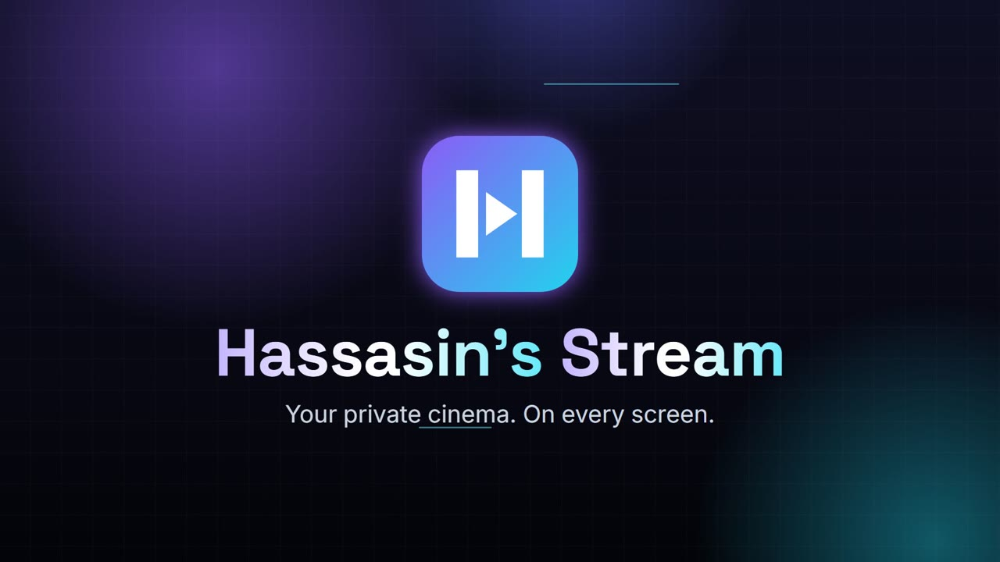
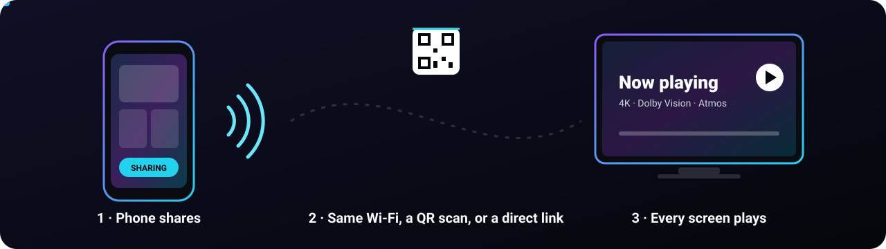
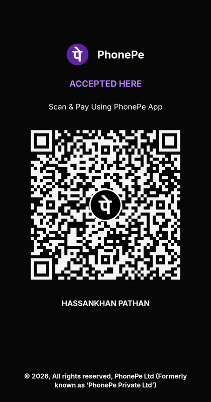

<p align="center">
  
</p>

<p align="center">
  <a href="../../releases/latest"></a>
  <a href="../../releases"></a>
  
  
</p>

<h3 align="center">Your films, shows and music, from your phone to every screen in the house.<br>No server. No account. No cloud. No subscription.</h3>

<p align="center">
  <a href="#-get-started-in-2-minutes"><b>Get started</b></a> ·
  <a href="#-api-keys-step-by-step"><b>API keys</b></a> ·
  <a href="#-four-looks-one-app"><b>Layouts</b></a> ·
  <a href="#-troubleshooting"><b>Help</b></a>
</p>

---

<p align="center">
  <a href="https://github.com/Dataman252/HassasinsStream/releases/download/v1.4/hassasins-stream-hype.mp4"></a><br>
  <sub>▶ <a href="https://github.com/Dataman252/HassasinsStream/releases/download/v1.4/hassasins-stream-hype.mp4">Watch the 30-second trailer</a></sub>
</p>

## ✨ Why it's different

<table>
<tr>
<td width="33%" valign="top">

### 📱 The phone *is* the server
Pick the folders (or a USB drive) on your phone. Every TV, tablet and phone at home plays from it over Wi-Fi. Nothing gets uploaded anywhere.

</td>
<td width="33%" valign="top">

### 🎬 Real cinema quality
**4K, Dolby Vision, HDR10+, HDR10, HLG.** Dolby Atmos, Dolby Digital Plus and DTS go **untouched** to your TV or soundbar. The TV switches to the film's frame rate.

</td>
<td width="33%" valign="top">

### 🍿 Feels like a streaming app
Posters, plots, cast and trailers. Continue watching, Up next, skip intro, seek-bar previews, online subtitles, an equalizer and picture-in-picture.

</td>
</tr>
<tr>
<td valign="top">

### 🔗 Connect by QR code
The TV shows a code; scan it with the phone. Sharing turns on and the TV connects itself. **No router?** The TV makes its own direct Wi-Fi link.

</td>
<td valign="top">

### 🎨 Four layouts
**Glass, Spotlight, Material or Bento**, each with its own colours and type. Every device keeps its own pick.

</td>
<td valign="top">

### 🔄 Always up to date
When a new version is out, the app updates first: one tap downloads it, and Android installs it. Your library and history stay.

</td>
</tr>
</table>

## 🛰️ How it works

<p align="center"></p>

## 🚀 Get started in 2 minutes

**1. Install on every device.** Download **`HassasinStream.apk`** from the [latest release](../../releases/latest).

| Device | How to install |
|---|---|
| **Android phone or tablet** | Open the downloaded file and tap **Install**. If asked, allow your browser or file manager to install apps. |
| **Fire TV** | Install **Downloader** from the Amazon Appstore. In Fire TV **Settings › My Fire TV › Developer options**, allow Downloader to install unknown apps. In Downloader, enter the release link and install. |
| **Android TV / Google TV** | Use a file-sending app (such as Send Files to TV) or a USB stick, then open the APK with a file manager. |

**2. Share from the phone with the videos.** Open the app › **Share this device** › **Choose folders** › tap **Sharing is off** to turn it on.

**3. Watch.** Open the app on the TV. It finds the phone by itself, or tap **Scan TV code** on the phone and point it at the code on the TV.

> [!IMPORTANT]
> Android or **Google Play Protect** may say it hasn't seen the app before and offer to scan it. That's normal for apps from outside the Play Store: choose **Scan app** (or **Install anyway**).

> [!TIP]
> You only download the APK once. After that the app keeps itself on the newest version. The first time, Android asks you to allow **Install unknown apps** for Hassasin's Stream.

## 🔑 API keys, step by step

The app plays everything **without any keys**. Keys add the streaming-app polish. Both keys are **free**, and you enter them **once, on the sharing phone only**. TVs and other phones ask that phone, which looks things up for them, so the keys never leave it.

| Key | What it unlocks | Without it |
|---|---|---|
| **TMDB** | Posters, backdrops, plots, cast, ratings, trailers, episode names | Shows get artwork from **TVmaze** and films a summary from **Wikipedia** automatically; anything else shows a picture from inside the video |
| **OpenSubtitles** | Searching and downloading subtitles in any language from the player | Subtitle files next to the video, and subtitles inside the file, still work |

### 🎞️ TMDB (The Movie Database)

1. Go to **[themoviedb.org/signup](https://www.themoviedb.org/signup)** and create a free account. Confirm the email they send.
2. Open **[Settings › API](https://www.themoviedb.org/settings/api)** and click **Create** (or *Request an API key*).
3. Choose **Developer**, accept the terms, and fill in the short form. For *Type of use* choose **Personal**. Any app name, such as *Home media*, is fine, and the URL can be your GitHub profile.
4. You get **two** values. Either works:
   - **API Key**: 32 characters, easier to type on a phone.
   - **API Read Access Token**: a long token starting with `eyJ…`, best for copying and pasting.
5. On the sharing phone: **Hassasin's Stream › Share this device › API keys**, paste it into **TMDB**, then tap **Save and check**.

### 💬 OpenSubtitles

1. Create a free account at **[opensubtitles.com](https://www.opensubtitles.com/en/users/sign_up)**. It must be the **.com** site; the old *.org* site does not work.
2. Open **[API consumers](https://www.opensubtitles.com/en/consumers)** from your profile menu and click **New consumer**.
3. Give it any name, tick **Under dev**, and save.
4. Copy the **API key** it shows.
5. On the sharing phone: **Share this device › API keys**, paste it into **OpenSubtitles**, then tap **Save and check**.

> [!NOTE]
> Free OpenSubtitles accounts can download a limited number of subtitles per day. The app says so when the limit is reached.

### 🚦 What the key status means

| Status | Meaning | What to do |
|---|---|---|
| 🟢 **Active** | The key works | Nothing. Enjoy |
| 🟡 **Checking** | Being tested right now | Wait a few seconds |
| 🟡 **Could not check: no internet** | The phone is offline | Connect the phone to the internet, then tap **Save and check** |
| 🔴 **Rejected** | The service refused the key | Copy it again, with no spaces before or after. For TMDB, try the other of the two values |
| ⚪ **No key** | Nothing entered yet | Follow the steps above |

### 💾 Back up your keys

**API keys › Save keys to a file** writes `hassasin-keys.json`. After a reset or on a new phone, use **Import from a file**. Keep the file private, since it holds your keys:

```json
{
  "tmdb_key": "your TMDB key or token",
  "opensubtitles_api_key": "your OpenSubtitles key"
}
```

## 🎨 Four looks, one app

<p align="center"></p>

**Settings › Layout.** Every layout brings its own palette and typeface, and the colours, glass style and app icon can still be changed under **Look**.

## 🔗 Connecting without typing

- **Same Wi-Fi:** the TV lists the sharing phone by itself. Press OK.
- **QR code:** on the TV's start screen, scan the code from the phone (**Share this device › Scan TV code**).
- **No router:** on the TV press **No router? Direct link**. The TV makes its own Wi-Fi network, and the phone joins it from the same QR code. If the TV can't, turn on the **phone's hotspot**, connect the TV to it once, then scan.

## 🛠️ Troubleshooting

<details>
<summary><b>Sharing stops when the phone's screen locks</b></summary>

Open **Share this device** and work through **Keep sharing when the screen locks**. Phone makers (vivo, Samsung, Xiaomi, OPPO) add their own background limits on top of Android's. The **Open** buttons take you to the right page. **Recent events** on the same screen shows exactly when Wi-Fi dropped or the phone slept.
</details>

<details>
<summary><b>The phone gets warm</b></summary>

Making seek-bar pictures is the hard work. It now goes slowly and pauses by itself above 40 °C. Watching devices copy finished pictures in one go instead of asking for them one by one. The **Phone health** card shows the temperature. Playback is never affected.
</details>

<details>
<summary><b>A film or show has the wrong poster</b></summary>

Open its page and choose **Fix match**. Search for the right title and pick it. You can also mark it **Not a film or show**.
</details>

<details>
<summary><b>Colours look wrong or the resolution drops after HDR on a TV</b></summary>

From 1.2 on, the TV's own display mode is restored after the player closes. If it still happens, turn off **Match frame rate** in the player's settings.
</details>

<details>
<summary><b>DTS-HD shows as DTS on my soundbar</b></summary>

Some TV sticks (Fire TV Stick 4K included) can only send the DTS core over HDMI. **Settings › This device** explains what your setup can pass through.
</details>

<details>
<summary><b>"Update required" will not go away</b></summary>

Tap **Update now**. If Android shows **Install unknown apps**, switch it on for Hassasin's Stream and go back. With no internet the app opens as usual and updates later.
</details>

## 🧩 Requirements

- **Sharing:** Android 11 or newer phone (USB drives work through an OTG adapter, ideally a powered hub).
- **Watching:** Android TV, Google TV, Fire TV (Fire OS 7+), or any Android 9+ phone or tablet.

## 🏗️ Building from source

```bash
git clone https://github.com/Dataman252/HassasinsStream.git
cd HassasinsStream
./gradlew :receiver:assembleDebug     # use the JDK bundled with Android Studio
```

The app lives in `receiver/` (it is both the sharing phone and the player); the shared message format is in `protocol/`.

## ☕ Support the developer

Hassasin's Stream is free, with no ads and no accounts. If it makes your movie nights better, you can buy the developer a coffee over **UPI** (PhonePe, Google Pay, Paytm, BHIM or any UPI app).

<p align="center">
  <br>
  <sub>Scan with any UPI app · UPI ID <code>7016587945-2@axl</code></sub>
</p>

The app also offers this once per new version (**Settings › About › Support the developer** anytime), with **Not now** and **Don't ask again**.

## 👤 Author

**Hassan Khan** · [hkhan25295@gmail.com](mailto:hkhan25295@gmail.com)

Ideas, bug reports and feedback are welcome, by email or through [GitHub issues](../../issues).

## 🙏 Credits


- Designed and built by **Hassan Khan** ([hkhan25295@gmail.com](mailto:hkhan25295@gmail.com)).

- Film and show information and images from **[TMDB](https://www.themoviedb.org)**. *This product uses the TMDB API but is not endorsed or certified by TMDB.*
- Show information from **[TVmaze](https://www.tvmaze.com)** (CC BY-SA) and film summaries from **[Wikipedia](https://www.wikipedia.org)** (CC BY-SA).
- Subtitles from **[OpenSubtitles.com](https://www.opensubtitles.com)**.
- Playback by **Media3 / ExoPlayer** and **LibVLC**; fonts listed in [FONTS.md](FONTS.md).
